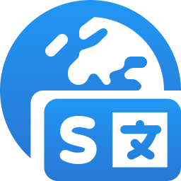

<p align="center">
  
</p>

<h1 align="center">Sentiary Tools</h1>

<p align="center">
  Localization tools for your terminal, builds, and AI assistants.
</p>

<p align="center">
  <a href="https://github.com/MateeDevs/sentiary-tools/actions/workflows/staging.yml"></a>
  <a href="https://github.com/MateeDevs/sentiary-tools/actions/workflows/staging-plugin.yml"></a>
  <a href="https://github.com/MateeDevs/sentiary-tools/actions/workflows/docs.yml"></a>
  <a href="https://github.com/MateeDevs/sentiary-tools/releases"></a>
</p>

<p align="center">
  <a href="https://docs.staging.sentiary.coolify.matee.cz/">Documentation</a> ·
  <a href="docs/content/getting-started/installation.md">Install</a> ·
  <a href="docs/content/getting-started/quickstart.md">Quickstart</a> ·
  <a href="contributing/development.md">Contribute</a>
</p>

## From translations to your app

- **One configuration.** Download Android, Compose Multiplatform, and Xcode resources with a TOML config.
- **Part of your build.** Generate and stage translations with the Gradle settings plugin.
- **Ready offline.** Restore a previously downloaded export set without a network connection.
- **Made for automation.** Manage projects, languages, and translations from the CLI or through hosted MCP.

## Get started

[Install the CLI](docs/content/getting-started/installation.md), then configure your project and download translations:

```sh
sentiary-cli init
sentiary-cli pull --dry-run
sentiary-cli pull
```

## Explore

| Tool | Guide |
| --- | --- |
| CLI | [Commands](docs/content/cli/reference.md) · [Configuration](docs/content/configuration/reference.md) · [Mobile apps](docs/content/cli/mobile.md) |
| Gradle plugin | [Setup](docs/content/gradle/index.md) · [Android and Compose](docs/content/gradle/guides.md) |
| AI assistants | [Hosted MCP](go/README.md#hosted-mcp) · [CLI skill](.agents/skills/sentiary-cli/SKILL.md) · [MCP skill](.agents/skills/sentiary-mcp/SKILL.md) |

[Development](contributing/development.md) · [Documentation maintenance](contributing/maintenance.md) · [Troubleshooting](docs/content/troubleshooting.md)
